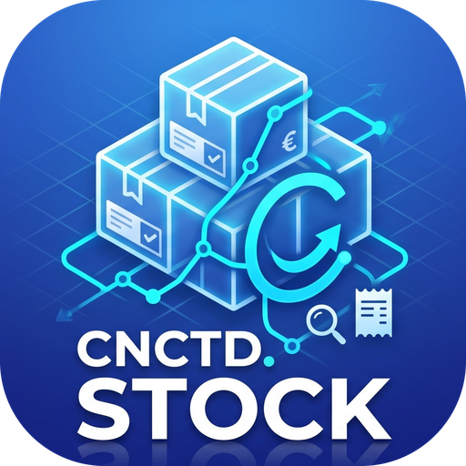
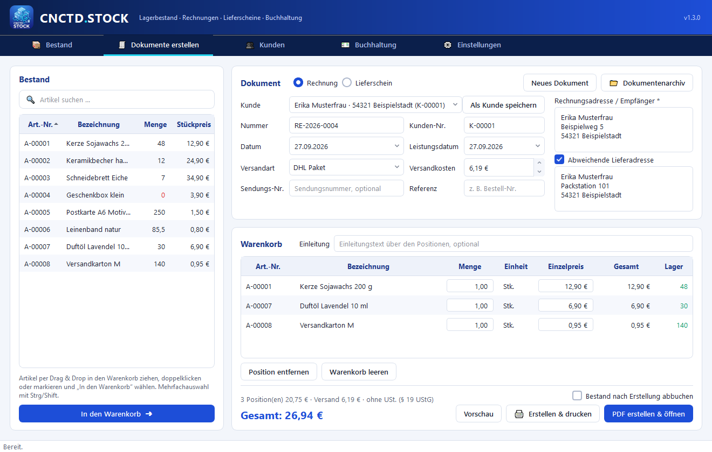
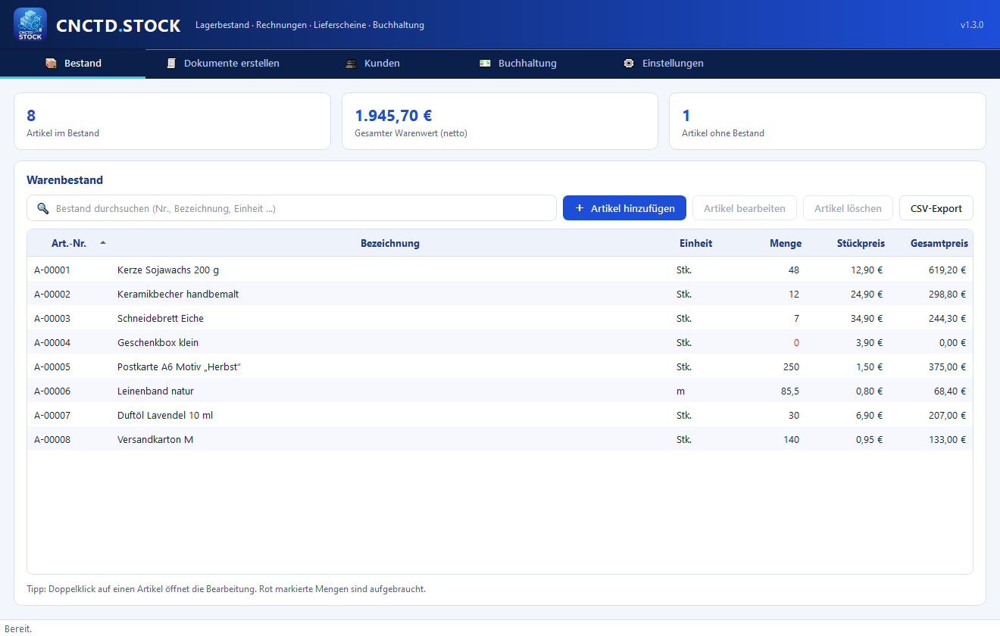
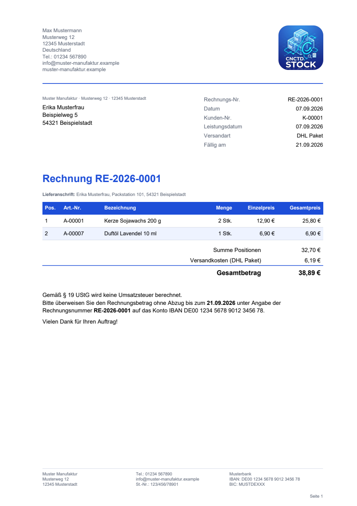
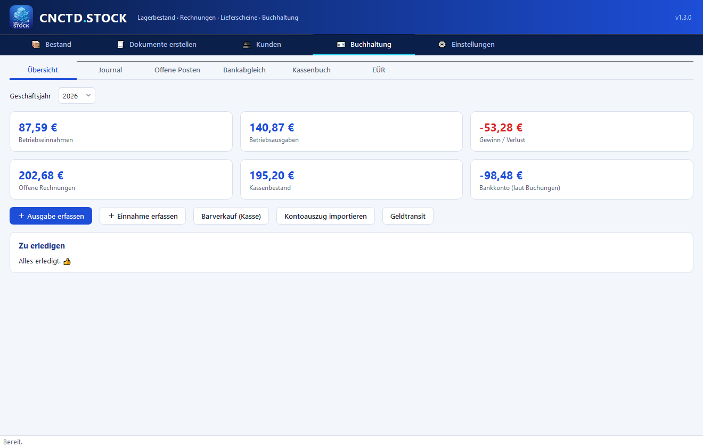
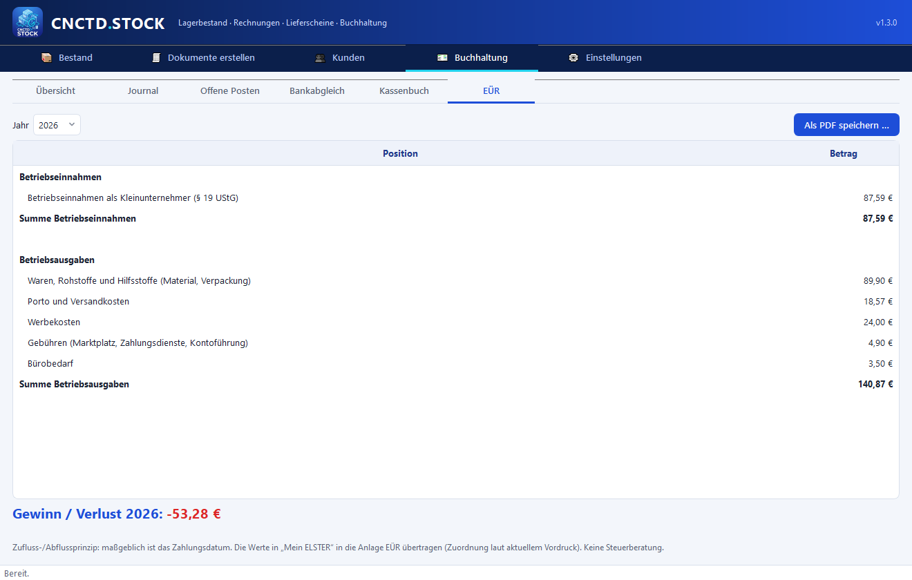

<p align="center">
  
</p>

<h1 align="center">CNCTD.STOCK</h1>

<p align="center">
  Lagerbestand · Rechnungen · Lieferscheine · Buchhaltung (EÜR)<br>
  Kostenlose Windows-Desktop-Anwendung für Selbstständige, Kleinunternehmen, Vereine und private Lager.
</p>

<p align="center">
  <a href="../../releases/latest"><b>⬇ Download</b></a> ·
  <a href="#funktionen">Funktionen</a> ·
  <a href="#gobd">GoBD</a> ·
  <a href="#aus-dem-quellcode-bauen">Selbst bauen</a> ·
  <a href="CHANGELOG.md">Änderungen</a>
</p>

---



> **English:** CNCTD.STOCK is a free, open-source Windows desktop app for inventory management, invoices
> and delivery notes, with an optional bookkeeping module for German small businesses (EÜR). The user
> interface is currently **German only**; the inventory and document features work anywhere, the tax
> features follow German law (GoBD, § 19 UStG, Anlage EÜR).

## Download & Start

1. Unter [**Releases**](../../releases/latest) entweder
   - `CNCTD.STOCK.exe` herunterladen (portabel, keine Installation nötig) **oder**
   - `CNCTD.STOCK_Setup.exe` (Installer mit Startmenü-Eintrag, ohne Administratorrechte).
2. Starten. Beim ersten Start öffnen sich die **Einstellungen**: Firmendaten, Logo, Steuernummer und
   Bankverbindung eintragen und speichern. Mit **Test-Rechnung** das Layout prüfen.

> Windows SmartScreen kann beim ersten Start warnen, weil die Datei nicht digital signiert ist
> („Weitere Informationen“ → „Trotzdem ausführen“). Der vollständige Quellcode liegt hier im Repository.

## Funktionen

| Bereich | Inhalt |
|---|---|
| **Bestand** | Artikel mit Nummer, Einheit, Menge, Stückpreis und Warenwert; Suche, Sortierung, CSV-Export, Kennzahlen |
| **Dokumente** | Rechnungen und Lieferscheine per Drag & Drop aus dem Bestand; Kunde wählen, abweichende Lieferadresse, Versandart, Versandkosten, Sendungsnummer; Bestand automatisch abbuchen; PDF mit eigenem Logo; Vorschau mit Wasserzeichen „ENTWURF“ |
| **Kunden** | Kundenstamm mit Rechnungs- und Lieferadresse, bevorzugter Versandart und Belegzähler |
| **Archiv** | Alle Belege revisionssicher archiviert; Stornorechnungen statt Löschen; Sendungsnummern nachtragen |
| **Buchhaltung** *(optional)* | Einnahmen-Überschuss-Rechnung: Ausgaben mit Beleg (PDF/Foto), offene Posten, Kontoauszug-Import (Bank-CSV, CAMT.053, PayPal) mit Zuordnungsvorschlägen, Kassenbuch, Geldtransit und Privatbuchungen, EÜR als PDF für „Mein ELSTER“ |
| **Einstellungen** | Absender, Logo, Steuerangaben, Kleinunternehmerregelung (§ 19 UStG), Versandarten, Nummernkreise, Datensicherung, Datenexport für die Betriebsprüfung, Verfahrensdokumentation |

<table>
  <tr>
    <td></td>
    <td></td>
  </tr>
  <tr>
    <td></td>
    <td></td>
  </tr>
</table>

<sub>Alle Screenshots zeigen frei erfundene Demo-Daten (`tools/make_screenshots.py`).</sub>

## GoBD

CNCTD.STOCK setzt die technischen Anforderungen der GoBD um. Ein offizielles GoBD-Zertifikat für
Software gibt es nicht – ordnungsgemäß ist immer das Gesamtverfahren aus Programm, Nutzung und
**Verfahrensdokumentation** (Vorlage: im Programm unter Einstellungen oder
[docs/Verfahrensdokumentation_Vorlage.docx](docs/Verfahrensdokumentation_Vorlage.docx)).

| Anforderung | Umsetzung |
|---|---|
| Unveränderbarkeit | Belege und Buchungen können nicht gelöscht oder geändert werden (Datenbank-Trigger); Original-PDFs, Eingangsbelege und Kontoauszüge schreibgeschützt im Archiv mit SHA-256-Prüfsumme |
| Korrekturen | Stornorechnung bzw. Stornobuchung mit Grund und Verweis auf das Original |
| Ordnung & Vollständigkeit | Automatische, fortlaufende Nummern (`RE-`, `ST-`, `LS-`, `B-JJJJ-NNNN`); Zähler nur erhöhbar |
| Nachvollziehbarkeit | Änderungsprotokoll für Artikel, Bestände, Kunden, Einstellungen, Belege und Buchungen – per SHA-256 verkettet |
| Zeitgerechte Erfassung | Beleg- und Erfassungsdatum getrennt; Warnungen bei unplausiblem Datum; Kassenbestand nie negativ |
| Prüfbarkeit | „Integrität prüfen“ kontrolliert Protokollkette, Belegdaten und Archivdateien |
| Datensicherung | ZIP mit Datenbank und Archiv; das Zurückspielen älterer Stände, die Belege entfernen würden, wird abgelehnt |
| Datenzugriff (Z3) | Export für die Betriebsprüfung: CSV + `index.xml` (GDPdU-Beschreibungsstandard) + alle Belege |

## Haftungsausschluss

CNCTD.STOCK wird ohne Gewähr bereitgestellt (siehe [Lizenz](LICENSE)). Die Software ersetzt **keine
Steuer- oder Rechtsberatung**. Prüfen Sie Rechnungsangaben, Aufbewahrungspflichten und die
EÜR-Werte im Zweifel mit einer Steuerberaterin bzw. einem Steuerberater. Nicht enthalten sind unter
anderem: direkte ELSTER-Übermittlung, automatischer Bankabruf (FinTS), Anlagenverzeichnis/AfA-Berechnung,
E-Rechnungen (XRechnung/ZUGFeRD) und Registrierkassen-/TSE-Funktionen.

## Datenablage

- Liegt die `.exe` in einem beschreibbaren Ordner (Desktop, USB-Stick …), speichert sie alles **portabel**
  im Unterordner `data\` daneben: Datenbank, `archiv\` (Original-PDFs, Belege, Kontoauszüge), `assets\`
  (Logo) und `sicherungen\`.
- Bei Installation unter „Programme“ wird `%APPDATA%\CNCTD.STOCK` verwendet.
- Die Daten verlassen den Rechner nie – keine Cloud, keine Telemetrie.

Bitte regelmäßig **Einstellungen → Datensicherung erstellen** nutzen und die ZIP-Datei extern aufbewahren.

## Aus dem Quellcode bauen

Voraussetzungen: Windows 10/11, Python 3.11, optional [Inno Setup 6](https://jrsoftware.org/isdl.php)
für den Installer.

```bat
build.bat
```

`build.bat` legt eine virtuelle Umgebung an, installiert die Abhängigkeiten, erzeugt Icon und
UI-Grafiken und baut `dist\CNCTD.STOCK.exe` (PyInstaller) sowie – falls Inno Setup vorhanden ist –
`installer\Output\CNCTD.STOCK_Setup.exe`.

Entwicklung und Tests:

```bat
py -3.11 -m venv .venv
.venv\Scripts\pip install -r requirements.txt -r requirements-dev.txt
.venv\Scripts\python main.py
.venv\Scripts\python -m pytest
```

Mit der Umgebungsvariable `CNCTD_STOCK_DATA_DIR` lässt sich ein eigener Datenordner vorgeben
(z. B. für Tests oder getrennte Firmen).

### Projektstruktur

```
main.py                     Startpunkt
cnctd_stock/
  database.py               SQLite-Schema, Schutz-Trigger, Änderungsprotokoll
  gobd.py                   Archiv, Belegerstellung, Storno, Integrität, Sicherung, Z3-Export, Verfahrensdoku
  accounting.py             Buchhaltung: Journal, offene Posten, Bankimport, Kassenbuch, EÜR
  pdf_engine.py             PDF-Vorlagen (ReportLab)
  formatting.py, paths.py   Zahlenformate, Pfade
  ui/                       Oberfläche (PySide6)
tests/                      Automatische Tests (pytest)
tools/                      Icon, UI-Grafiken, Demo-Screenshots
installer/                  Inno-Setup-Skript
```

## Lizenz

[MIT](LICENSE) © 2026 CNCTD.VERSE (NEZ839). Verwendete Bibliotheken und deren Lizenzen:
[THIRD_PARTY_NOTICES.md](THIRD_PARTY_NOTICES.md).
